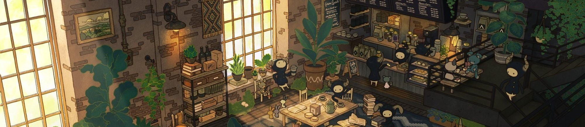

 

## **Hello, I'm Jiten** 

I enjoy learning new things, understanding how they work, and finding simple solutions to everyday problems. I like building things, experimenting with ideas, and occasionally making things more complicated than they need to be. Still figuring things out, one problem at a time.

- **Editor:** Neovim 🗿
- **Current OS:** Fedora
- **Terminal:** Ghostty + tmux
- **Favourite keyboard:** Kinesis Advantage Pro (KB510)
- **Favourite language:** Still Deciding; Odin looks promising.
- **Favourite books:** *Clean Code*, *The Pragmatic Programmer*, *The Phoenix Project*
- **Philosophy:** Make it work, make it right, make it simple.
- **Fun fact:** I spend a questionable amount of time configuring my keymaps.

> Continuous learning.
 

 

